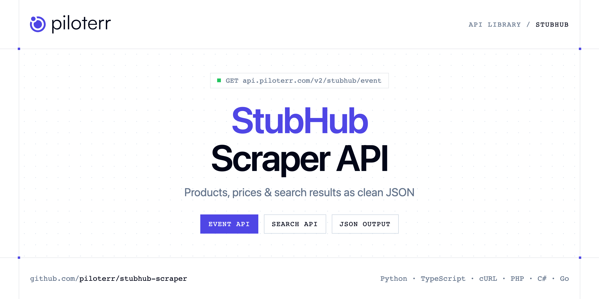

<p align="center">
  <a href="https://www.piloterr.com"></a>
</p>

# StubHub Scraper API

[](https://discord.gg/CFj3ph8aHU) [](https://app.piloterr.com) [](https://app.piloterr.com/openapi) [](LICENSE)

The **Piloterr StubHub Scraper API** lets you extract public data from StubHub as **clean, structured JSON** — no proxies, headless browsers or HTML parsing to maintain. Endpoints available in production:

- **StubHub Event API** — Read one StubHub event from its URL or numeric id, including the lowest printed ticket price.
- **StubHub Search API** — Search StubHub events by keyword or by a StubHub search URL.

Use it for price monitoring, assortment tracking, competitor analysis, product research or catalog enrichment.

| Endpoint | Path | Credits | What you get |
|---|---|---|---|
| [StubHub Event API](#stubhub-event-api) | `/v2/stubhub/event` | 2 | Read one StubHub event from its URL or numeric id, including the lowest printed ticket price. |
| [StubHub Search API](#stubhub-search-api) | `/v2/stubhub/search` | 1 | Search StubHub events by keyword or by a StubHub search URL. The response is the first embedded page. |

## Table of contents

- [How it works](#how-it-works)
- [StubHub Event API](#stubhub-event-api)
- [StubHub Search API](#stubhub-search-api)
- [Code examples in other languages](#code-examples-in-other-languages)
- [Practical use cases](#practical-use-cases)
- [Why Piloterr?](#why-piloterr)
- [FAQ](#faq)
- [Official SDKs](#official-sdks)
- [Related scrapers](#related-scrapers)
- [Support](#support)

## How it works

1. **Create a free Piloterr account** and copy your API key from the [dashboard](https://app.piloterr.com).
2. **Send a `GET` (or `POST`) request** to `https://api.piloterr.com/v2/...` with the header `x-api-key: YOUR_API_KEY`.
3. **Receive structured JSON** — Piloterr handles rendering, proxies, retries and parsing.

```bash
export PILOTERR_API_KEY="your-api-key"
pip install requests        # Python
# TypeScript: Node.js 18+ (native fetch), run with `npx tsx file.ts`
```

> Every endpoint accepts both `GET` (query string) and `POST` (JSON body with the same fields).

## StubHub Event API

Read one StubHub event from its URL or numeric id, including the lowest printed ticket price.

`GET | POST https://api.piloterr.com/v2/stubhub/event` · **2 credits per request** · [Full reference](https://app.piloterr.com/openapi)

### Request parameters

| Parameter | Type | Required | Description |
|---|---|---|---|
| `query` | string | ✅ | Required. StubHub event URL or numeric id, for example 162387399 or https://www.stubhub.com/harlem-globetrotters-marseille-tickets-3-31-2027/event/162387399/. A keyword is rejected. |

### Python example

```python
import json
import os
import requests

response = requests.get(
    "https://api.piloterr.com/v2/stubhub/event",
    headers={"x-api-key": os.environ["PILOTERR_API_KEY"]},
    params={
        "query": "https://www.stubhub.com/harlem-globetrotters-marseille-tickets-3-31-2027/event/162387399/",
    },
    timeout=120,
)
response.raise_for_status()
data = response.json()

print(json.dumps(data, indent=2, ensure_ascii=False)[:2000])
```

### TypeScript example

```typescript
type StubhubEvent = {
  id?: string;
  url?: string;
  date?: unknown;
  name?: string;
  time?: unknown;
  year?: unknown;
  image?: string;
  price?: number;
  country?: string;
  currency?: string;
  start_at?: string;
  venue_city?: string;
  venue_name?: string;
  day_of_week?: unknown;
  description?: string;
  country_code?: unknown;
  price_display?: string;
  venue_location?: string;
  is_parking_event?: unknown;
  has_active_listings?: boolean;
};

const params = new URLSearchParams({
  "query": "https://www.stubhub.com/harlem-globetrotters-marseille-tickets-3-31-2027/event/162387399/",
});

const response = await fetch(`https://api.piloterr.com/v2/stubhub/event?${params}`, {
  headers: { "x-api-key": process.env.PILOTERR_API_KEY! },
});
if (!response.ok) throw new Error(`Piloterr error ${response.status}: ${await response.text()}`);

const data = (await response.json()) as StubhubEvent;

console.log(JSON.stringify(data, null, 2).slice(0, 2000));
```

<details>
<summary><b>POST variant</b></summary>

```http
POST https://api.piloterr.com/v2/stubhub/event
x-api-key: YOUR_API_KEY
Content-Type: application/json

{"query": "https://www.stubhub.com/harlem-globetrotters-marseille-tickets-3-31-2027/event/162387399/"}
```
</details>

### Output example

Example response from the API reference, abridged — real values depend on the page you scrape.

```json
{
  "id": "162387399",
  "url": "https://www.stubhub.com/harlem-globetrotters-marseille-tickets-3-31-2027/event/162387399/",
  "date": null,
  "name": "Harlem Globetrotters",
  "time": null,
  "year": null,
  "image": "https://img.vggcdn.net/img/cat/11035/3/1.jpg",
  "price": 68,
  "country": "France",
  "currency": "EUR",
  "start_at": "2027-03-31T19:00:00",
  "venue_city": "Marseille",
  "venue_name": "Palais des Sports de Marseille",
  "day_of_week": null,
  "description": "Acheter et vendre Billets Harlem Globetrotters pour mars 31 à Palais des Sports de Marseille à Marseille sur StubHub ! Les billets sont c…",
  "country_code": null,
  "price_display": "68,00 €",
  "venue_location": "81 rue Raymond Teisseire, 13009, Marseille, France",
  "is_parking_event": null,
  "has_active_listings": true
}
```

### Response fields

| Field | Type | Description |
|---|---|---|
| `id` | string |  |
| `url` | string |  |
| `date` | object |  |
| `name` | string |  |
| `time` | object |  |
| `year` | object |  |
| `image` | string |  |
| `price` | integer |  |
| `country` | string |  |
| `currency` | string |  |
| `start_at` | string |  |
| `venue_city` | string |  |
| `venue_name` | string |  |
| `day_of_week` | object |  |
| `description` | string |  |
| `country_code` | object |  |
| `price_display` | string |  |
| `venue_location` | string |  |
| `is_parking_event` | object |  |
| `has_active_listings` | boolean |  |

## StubHub Search API

Search StubHub events by keyword or by a StubHub search URL. The response is the first embedded page.

`GET | POST https://api.piloterr.com/v2/stubhub/search` · **1 credit per request** · [Full reference](https://app.piloterr.com/openapi)

### Request parameters

| Parameter | Type | Required | Description |
|---|---|---|---|
| `query` | string | ✅ | Required. Keyword, for example nba, or a StubHub search URL such as https://www.stubhub.com/secure/search/?q=nba. An event URL is rejected. |
| `page` | number | — | Optional. Only page 1 returns events. Example: 1. Page 2 and above return 404 because the search document has no further page. |

### Python example

```python
import json
import os
import requests

response = requests.get(
    "https://api.piloterr.com/v2/stubhub/search",
    headers={"x-api-key": os.environ["PILOTERR_API_KEY"]},
    params={
        "query": "nba",
    },
    timeout=120,
)
response.raise_for_status()
data = response.json()

print(json.dumps(data, indent=2, ensure_ascii=False)[:2000])
```

### TypeScript example

```typescript
type StubhubSearch = {
  results?: {
    id?: string;
    url?: string;
    date?: string;
    name?: string;
    time?: string;
    year?: string;
    price?: unknown;
    country?: string;
    currency?: unknown;
    start_at?: unknown;
    venue_city?: string;
    venue_name?: string;
    day_of_week?: string;
    country_code?: string;
    price_display?: unknown;
    venue_location?: string;
    is_parking_event?: boolean;
    has_active_listings?: boolean;
  }[];
  pagination?: {
    next?: unknown;
    page?: number;
    per_page?: number;
    total_pages?: unknown;
    total_results?: number;
  };
};

const params = new URLSearchParams({
  "query": "nba",
});

const response = await fetch(`https://api.piloterr.com/v2/stubhub/search?${params}`, {
  headers: { "x-api-key": process.env.PILOTERR_API_KEY! },
});
if (!response.ok) throw new Error(`Piloterr error ${response.status}: ${await response.text()}`);

const data = (await response.json()) as StubhubSearch;

console.log(JSON.stringify(data, null, 2).slice(0, 2000));
```

<details>
<summary><b>POST variant</b></summary>

```http
POST https://api.piloterr.com/v2/stubhub/search
x-api-key: YOUR_API_KEY
Content-Type: application/json

{"query": "nba"}
```
</details>

### Output example

Example response from the API reference, abridged — real values depend on the page you scrape.

```json
{
  "results": [
    {
      "id": "162387399",
      "url": "https://www.stubhub.com/harlem-globetrotters-marseille-tickets-3-31-2027/event/162387399/",
      "date": "Mar 31 2027",
      "name": "Harlem Globetrotters",
      "time": "7:00 PM",
      "year": "2027",
      "price": null,
      "country": "France",
      "currency": null,
      "start_at": null,
      "venue_city": "Marseille",
      "venue_name": "Palais des Sports de Marseille",
      "day_of_week": "Wed",
      "country_code": "FR",
      "price_display": null,
      "venue_location": "Marseille, France",
      "is_parking_event": false,
      "has_active_listings": true
    }
  ],
  "pagination": {
    "next": null,
    "page": 1,
    "per_page": 20,
    "total_pages": null,
    "total_results": 2171
  }
}
```

### Response fields

| Field | Type | Description |
|---|---|---|
| `results[]` | object[] |  |
| `results[].id` | string |  |
| `results[].url` | string |  |
| `results[].date` | string |  |
| `results[].name` | string |  |
| `results[].time` | string |  |
| `results[].year` | string |  |
| `results[].price` | object |  |
| `results[].country` | string |  |
| `results[].currency` | object |  |
| `results[].start_at` | object |  |
| `results[].venue_city` | string |  |
| `results[].venue_name` | string |  |
| `results[].day_of_week` | string |  |
| `results[].country_code` | string |  |
| `results[].price_display` | object |  |
| `results[].venue_location` | string |  |
| `results[].is_parking_event` | boolean |  |
| `results[].has_active_listings` | boolean |  |
| `pagination` | object |  |
| `pagination.next` | object |  |
| `pagination.page` | integer |  |
| `pagination.per_page` | integer |  |
| `pagination.total_pages` | object |  |
| `pagination.total_results` | integer |  |

## Code examples in other languages

Ready-to-run examples live in the [`examples/`](examples) folder. Each one reads your key from the `PILOTERR_API_KEY` environment variable.

| Language | Event | Search |
|---|---|---|
| cURL (Bash) | [`event`](examples/curl/event.sh) | [`search`](examples/curl/search.sh) |
| PHP | [`event`](examples/php/event.php) | [`search`](examples/php/search.php) |
| C# | [`event`](examples/csharp/Event.cs) | [`search`](examples/csharp/Search.cs) |
| Go | [`event`](examples/go/event.go) | [`search`](examples/go/search.go) |
| Java | [`event`](examples/java/EventExample.java) | [`search`](examples/java/SearchExample.java) |
| Ruby | [`event`](examples/ruby/event.rb) | [`search`](examples/ruby/search.rb) |
| Node.js | [`event`](examples/nodejs/event.mjs) | [`search`](examples/nodejs/search.mjs) |

## Practical use cases

- **Price monitoring** — Track prices, promotions and availability over time to react to competitors.
- **Assortment & catalog tracking** — Follow new products, delisted items and category changes.
- **Competitor analysis** — Benchmark ranges, brands and positioning across retailers.
- **Product research** — Spot best-sellers and trends from search results.
- **Catalog enrichment** — Pull titles, images and attributes into your PIM or marketplace listings.

## Why Piloterr?

- **No infrastructure** — no proxies, headless browsers or CAPTCHA solving to run yourself.
- **Structured JSON** — stable, documented fields instead of brittle HTML selectors.
- **Pay per request** — transparent credit cost per endpoint, failed requests are retried for you.
- **One API key, hundreds of sources** — StubHub plus many other e-commerce, search and company data endpoints in the [Piloterr library](https://www.piloterr.com/library).
- **Any language** — plain HTTPS + JSON, with examples for Python, TypeScript, cURL, PHP, C#, Go, Java, Ruby and Node.js.

## FAQ

### Is it legal to scrape StubHub?

Collecting publicly available data is generally allowed in many jurisdictions, but rules depend on your country, the data you collect and how you use it. Avoid personal data unless you have a lawful basis, respect the website's terms where they apply, and get legal advice for your specific use case. This is not legal advice.

### Do I need proxies or a headless browser?

No. Piloterr handles rendering, proxy rotation and retries on its side. You only send an HTTPS request with your `x-api-key` header and receive JSON.

### How much does a request cost?

Credits per call: `/v2/stubhub/event` **2**, `/v2/stubhub/search` **1**. See the [Piloterr website](https://www.piloterr.com) for plans.

### What data does the StubHub API return?

Each endpoint returns structured JSON: **StubHub Event** — `id`, `url`, `date`, `name`, `time`, `year`; **StubHub Search** — `results[]`, `results[].id`, `results[].url`, `results[].date`, `results[].name`, `results[].time`.

### How do I paginate StubHub results?

Use the `page` parameter and keep requesting while the response indicates more results.

### Which languages are supported?

Any language that can make an HTTP request. This README shows Python and TypeScript; the [`examples/`](examples) folder contains cURL, PHP, C#, Go, Java, Ruby and Node.js.

## Official SDKs

Use Piloterr from your own language with a typed client:

| SDK | Package | Install |
| --- | --- | --- |
| Node.js | [`@piloterr/sdk`](https://www.npmjs.com/package/@piloterr/sdk) | `npm install @piloterr/sdk` |
| Python | [`piloterr`](https://pypi.org/project/piloterr/) | `pip install piloterr` |
| Go | [`piloterr-go`](https://pkg.go.dev/github.com/piloterr/piloterr-go) | `go get github.com/piloterr/piloterr-go` |
| .NET | [`Piloterr`](https://www.nuget.org/packages/Piloterr) | `dotnet add package Piloterr` |
| Ruby | [`piloterr`](https://rubygems.org/gems/piloterr) | `gem install piloterr` |
| PHP | [`piloterr/sdk`](https://packagist.org/packages/piloterr/sdk) | `composer require piloterr/sdk` |
| Java | [`piloterr-java`](https://github.com/piloterr/piloterr-java) | build from source, see its README |
| CLI | [`@piloterr/cli`](https://www.npmjs.com/package/@piloterr/cli) | `npm install -g @piloterr/cli` |
| MCP server | [`@piloterr/mcp`](https://www.npmjs.com/package/@piloterr/mcp) | `npx -y @piloterr/mcp` |

## Related scrapers

- [About You Scraper API](https://github.com/piloterr/aboutyou-scraper)
- [Action Scraper API](https://github.com/piloterr/action-scraper)
- [Aldi Scraper API](https://github.com/piloterr/aldi-scraper)
- [Alibaba Scraper API](https://github.com/piloterr/alibaba-scraper)
- [AliExpress Scraper API](https://github.com/piloterr/aliexpress-scraper)
- [Allegro Scraper API](https://github.com/piloterr/allegro-scraper)
- [All Piloterr scrapers on GitHub](https://github.com/piloterr)

## Support

- 💬 Join the [Piloterr Discord](https://discord.gg/CFj3ph8aHU) to ask questions and share what you build.
- 📚 Browse the [API reference (OpenAPI)](https://app.piloterr.com/openapi) and the [Piloterr library](https://www.piloterr.com/library).
- 🔑 [Get your API key](https://app.piloterr.com).

---

<p align="center">
  <a href="https://www.piloterr.com">
    <picture>
      <source media="(prefers-color-scheme: dark)" srcset="images/logo-dark.svg">
      
    </picture>
  </a>
  <br>
  <sub>Built by <a href="https://www.piloterr.com">Piloterr</a> — web scraping APIs for e-commerce, search, real estate and more, one API key.</sub>
</p>

<sub>StubHub is a trademark of its respective owner. This repository is not affiliated with or endorsed by StubHub. Examples are released under the MIT license.</sub>
